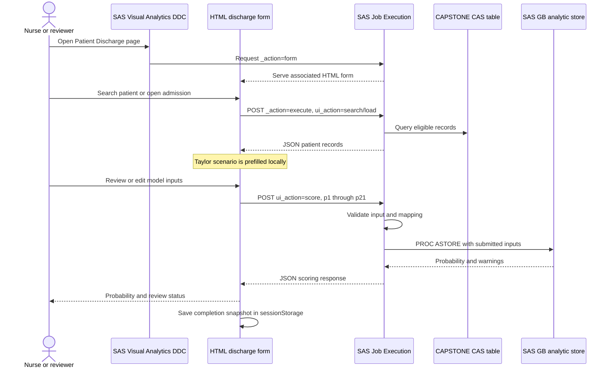
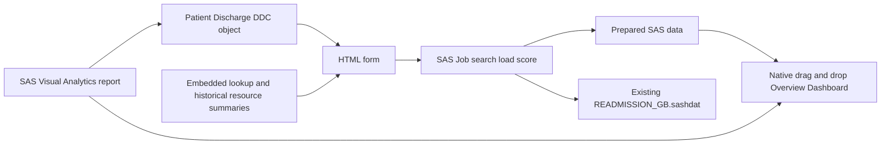
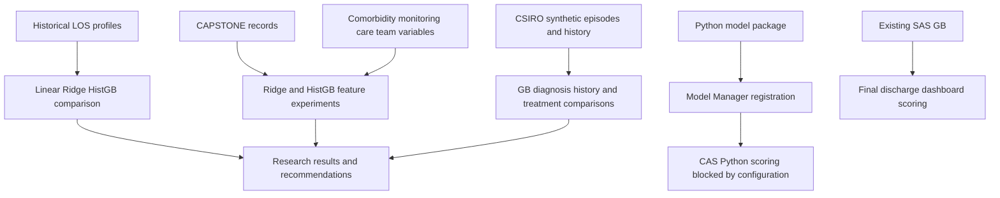
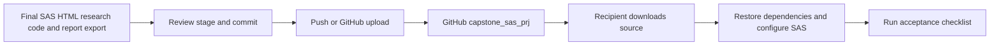

# Architecture and interactions

## Deployed patient interface

The landing/input page in this diagram is the attached HTML form. No separate
externally hosted landing page has been verified. VA-to-HTML single-admission
messages are optional when the user searches within the HTML form.

## Native report and custom interface

The Overview's chart-specific data bindings should be read from the report
definition rather than assumed identical to the patient Job's table. Displayed
resource summaries are an HTML build-time snapshot. Doctor selection is a model
input; nurse selection supports workflow attribution but is not a model input.

## Research and deployment decision

Local experimental models have not been established as the model inside the
final SAS analytic store. Their metrics must not be attached to that store as
deployment validation. The observed CAS restriction concerns external-language
execution, not a proven universal prohibition on Python under the license.

## Source control and handover

Changes committed through GitHub Upload files are already on GitHub; a separate
SAS Push is unnecessary for that upload. This is distinct from automatically
deploying the updated files to SAS, which remains a manual operation.
